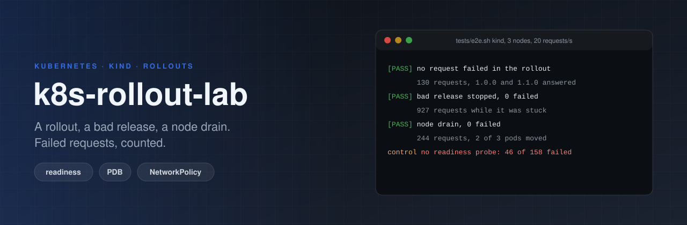

<p align="center"></p>

# k8s-rollout-lab

[](https://github.com/ErenOzgu/k8s-rollout-lab/actions/workflows/ci.yml)
-326CE5?logo=kubernetes&logoColor=white)


**Does a rollout drop requests?** A small service on Kubernetes, with the settings that decide the answer, and CI that
checks it on a real cluster ([kind](https://kind.sigs.k8s.io/)). A load generator keeps about twenty requests a second on the
service while the tests roll out a new version, ship a release that never becomes ready, drain a node and probe a
NetworkPolicy, and then count the requests that failed. A control experiment takes the safeguards away and must lose
requests, so a count of zero means something.

## Why

Most Kubernetes examples stop at "the pods are Running". What a user notices is failed requests: during a deploy,
during a node upgrade, when a release is slow to start. Each safeguard against that is a few lines of YAML (a readiness
probe, `maxUnavailable: 0`, a PodDisruptionBudget, graceful shutdown), and each can be removed or mis-set without any
error. Here each one has a test that notices.

## Try it

You need Docker, [kind](https://kind.sigs.k8s.io/) and kubectl.

```sh
git clone https://github.com/ErenOzgu/k8s-rollout-lab && cd k8s-rollout-lab
make e2e        # builds three images, creates a three-node kind cluster, runs tests/e2e.sh (about 4 minutes)
make control    # the same service without its safeguards: it must drop requests
make down       # delete the cluster
```

`make test` runs the unit tests of the service and the load generator with nothing but Python.

## What the cluster tests do

| Step | What happens | What must hold | In one CI run |
|---|---|---|---|
| **Rolling update** | image `1.0.0` to `1.1.0` | no request fails; both versions answered during it | 130 requests, 0 failed |
| **Bad release** | image `1.2.0-bad`, which starts, is alive and never becomes ready | the rollout is reported as failed (`ProgressDeadlineExceeded`); the three old pods keep serving; `kubectl rollout undo` brings `1.1.0` back; no request fails | 927 requests while it was stuck, 0 failed |
| **Node drain** | `kubectl drain` of the node that runs 2 of the 3 pods | the PodDisruptionBudget lets one pod go at a time; three ready pods end up on the other nodes; no request fails | 244 requests, 0 failed |
| **NetworkPolicy** | three probe pods | a labelled client in the same namespace gets 200; an unlabelled pod in the same namespace and a labelled pod in another namespace are blocked | 3 of 3 |
| **Pod Security** | server-side dry runs of pods in the prod namespace, which enforces `restricted` | the label is set; a pod built like the app's is admitted; a pod with no security context and a privileged pod are refused | 4 of 4 |
| **Whole run** | everything above, one load generator | not one failed request | 1858 requests, 0 failed |

Every step keeps the load running and counts the lines of its log that are not `200`. The same checks, with the
counts, are on the summary page of every CI run.

### The control

`tests/control.sh` deploys the same service **without a readiness probe**, with a release that takes three seconds to
start listening, and rolls it out under load. It passes only if requests fail: 46 of 158 requests failed in one CI run. If it saw none, "no request
failed" above could mean that the load generator is blind.

## What is deployed

| File | What it does |
|---|---|
| `k8s/base/deployment.yaml` | Three replicas, `maxSurge: 1` and `maxUnavailable: 0`, a readiness and a liveness probe, `progressDeadlineSeconds: 45`, a 30 s grace period, a non-root read-only container with no capabilities, no service-account token |
| `k8s/base/service.yaml` | A ClusterIP Service |
| `k8s/base/networkpolicy.yaml` | Ingress only from pods labelled `rollout-lab/access: client` in the same namespace |
| `k8s/overlays/prod` | Namespace (enforcing Pod Security `restricted`), a PodDisruptionBudget (`minAvailable: 2`), topology spread over nodes that never blocks scheduling |
| `k8s/overlays/dev` | One replica, and **no** budget: a budget on a one-pod Deployment would stop every node drain |
| `app/server.py` | The service: `/readyz` goes 503 on SIGTERM and it keeps answering for five more seconds; `START_DELAY` and `FAIL_READY` make slow and broken releases |
| `app/loadgen.py` | One line per request: time, status or `ERR`, and the version that answered |

The three images are the same code built with different arguments: `1.0.0` and `1.1.0` (two good releases) and `1.2.0-bad`
(starts, is alive, never becomes ready).

## How it is tested

| Job | What it proves |
|---|---|
| **Lint, unit tests and manifests** | `ruff`, `shellcheck`, `actionlint`; the unit tests of the service (readiness, slow start, never ready, drain timing on SIGTERM) and of the load generator; every overlay rendered with kustomize and validated by kubeconform against the Kubernetes 1.34 schemas |
| **A real cluster (kind), under load** | `tests/e2e.sh`, then `tests/control.sh`, on kind v0.33.0 with a pinned node image |

## Limits

- **kind is one machine.** No cloud load balancer, ingress or real node failure, and no slow network between nodes.
- **Small load.** About twenty small requests a second. A request fails if it is not a 200 within two seconds.
- **The load generator uses the ClusterIP**, so DNS is not under test (moving a DNS pod during a drain would not be the application's fault).
- **No autoscaling, no TLS, no image registry.** The HorizontalPodAutoscaler needs metrics-server and a test of its own; see the [roadmap](ROADMAP.md).
- **The rollback is a command, not automation.** The test runs `kubectl rollout undo` as a pipeline would; progressive delivery tools are left out on purpose.
- **Never run in production.** This is a lab.

## Layout

```text
app/            the service and the load generator (standard library only)
Dockerfile      one image, built three times by the tests
k8s/base        Deployment, Service, ServiceAccount, NetworkPolicy
k8s/overlays    dev and prod
tests/          cluster tests (e2e.sh, control.sh, lib.sh), kind config, unit tests, the control overlay
.github/        CI, and a release workflow that publishes the rendered manifests
```

## More

[Design notes](docs/design-notes.md) (why it is built this way, what was left out, how it was checked),
[CHANGELOG](CHANGELOG.md) and [ROADMAP](ROADMAP.md).

## License

MIT, see [LICENSE](LICENSE).
